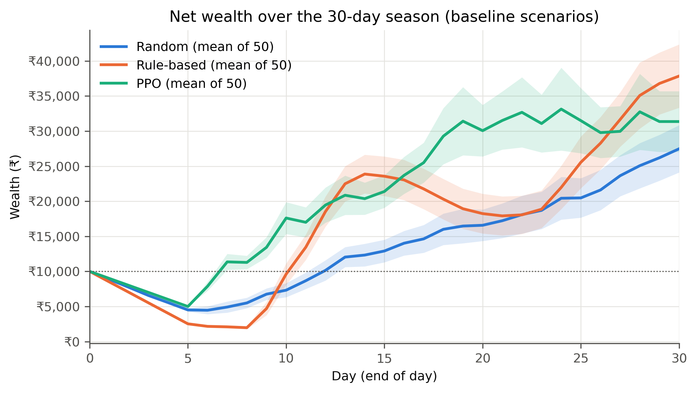
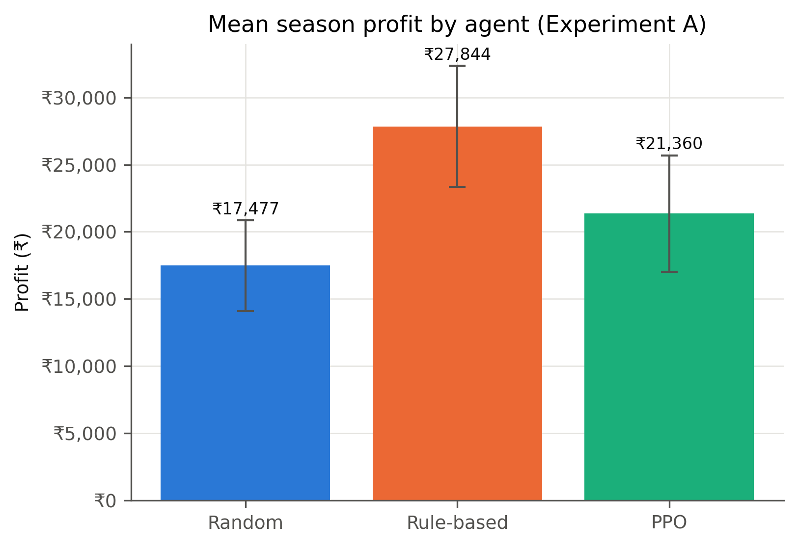
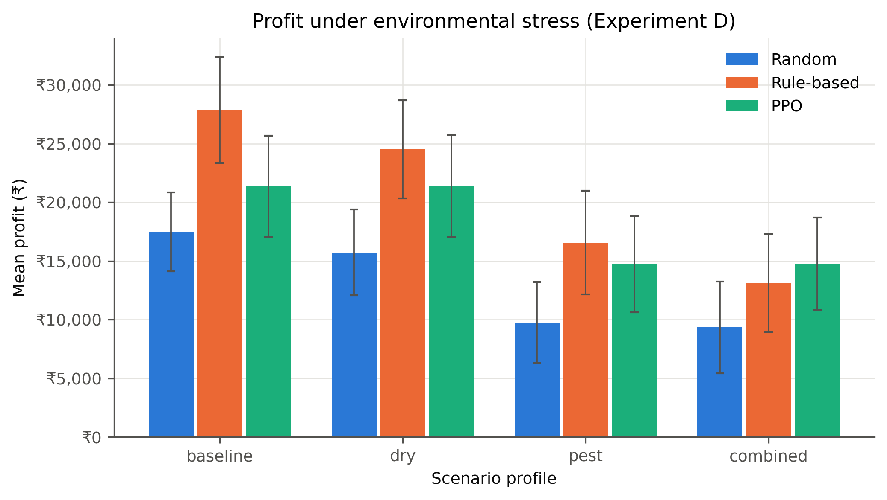
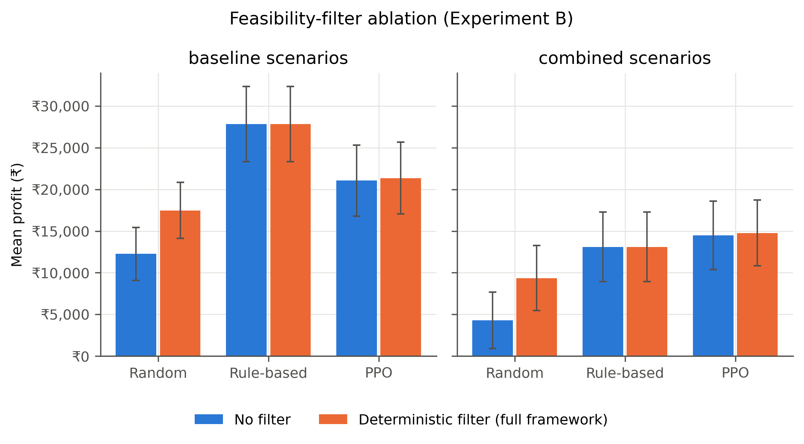
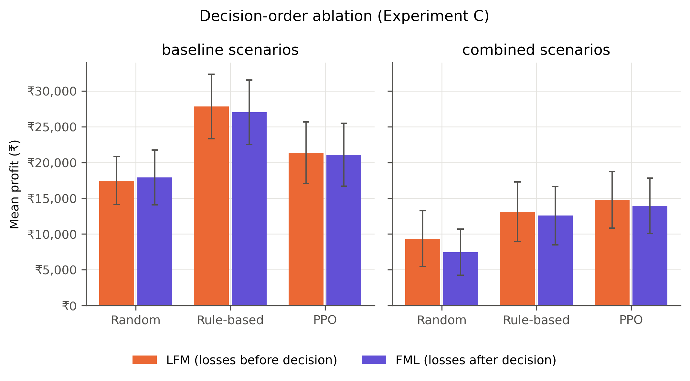
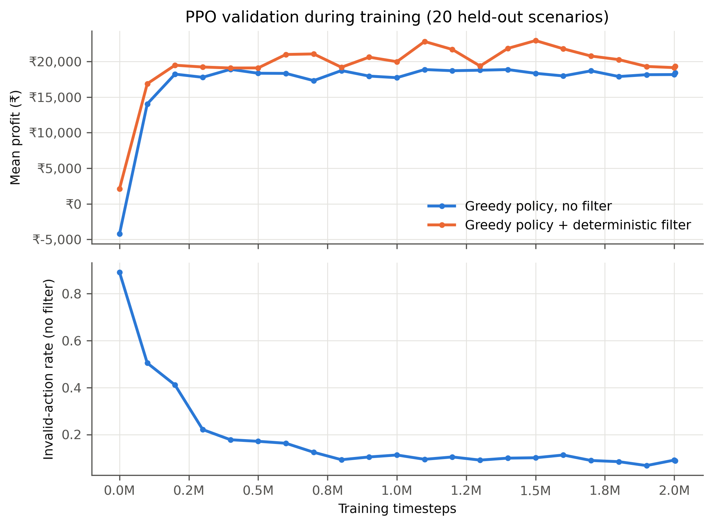
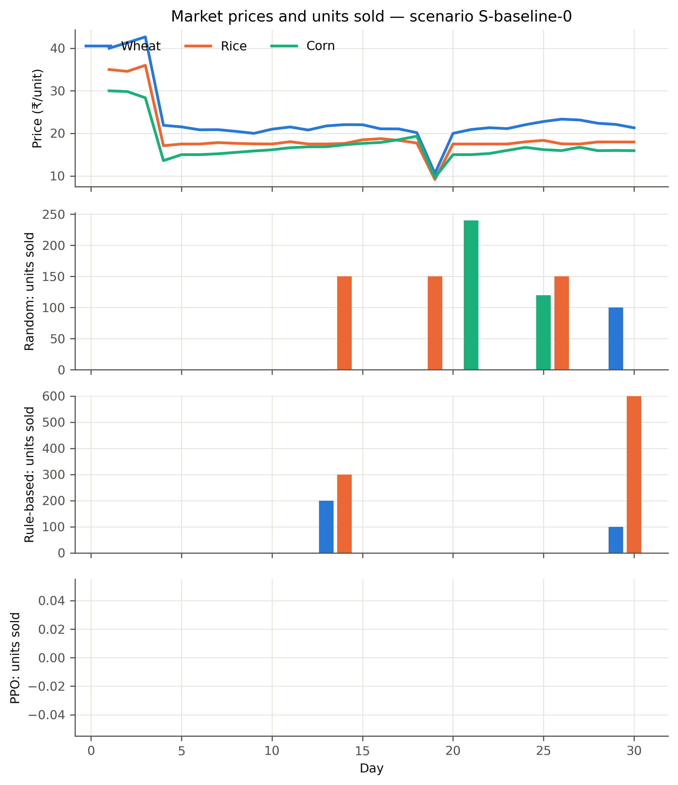
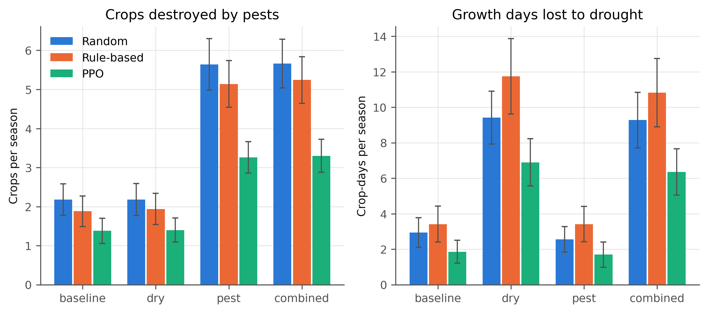
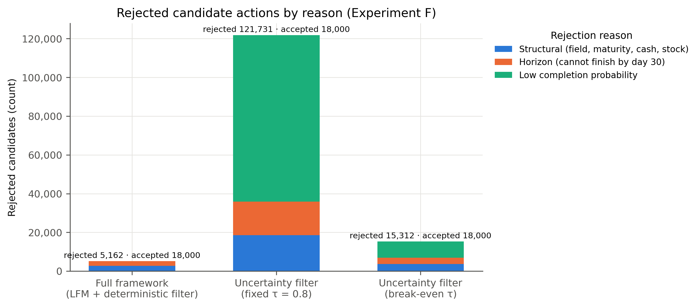
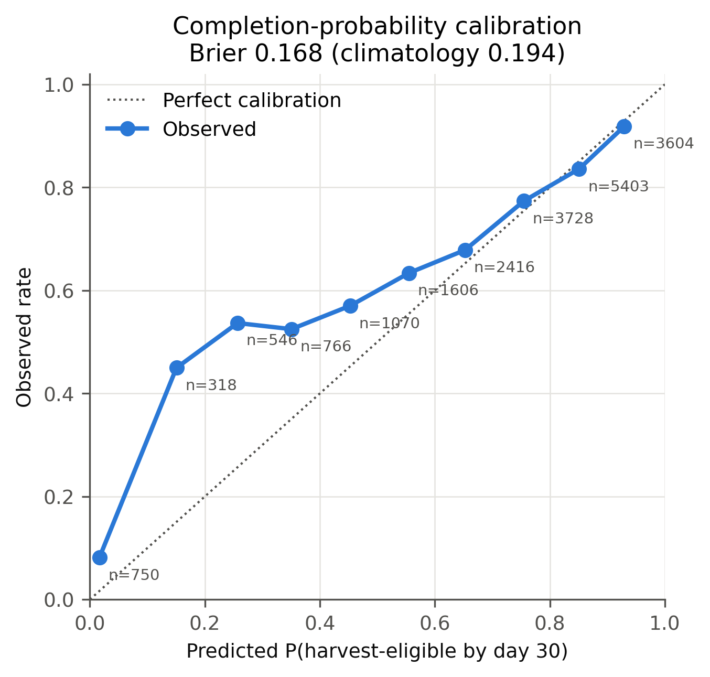

# Charts

Generated by `scripts/run_experiments.py` from `../data/` and `../logs/`. Each chart is saved as 300-dpi PNG and SVG.

## chart_1_wealth_over_30_days

Mean end-of-day wealth (cash + inventory at current price) across baseline scenarios, full framework; bands = 95 % CI of the mean. Growing crops carry no value until harvested, which produces the early dip. No completed human session exists yet, so the human curve is absent.

## chart_2_agent_profit_comparison

Mean profit over 50 baseline scenarios (full framework); error bars = 95 % CI.

## chart_3_weather_pest_robustness

Mean profit per agent and scenario profile (full framework), error bars = 95 % CI. dry: drought 15 %/day; pest: outbreaks 20 %/day; combined: both.

## chart_4_feasibility_ablation

Same agent, same scenarios; only the pre-execution filter changes. Error bars = 95 % CI.

## chart_5_decision_order_ablation

Only the position of the loss stage changes (deterministic filter, exogenous market). Error bars = 95 % CI.

## chart_6_human_vs_ai

NOT GENERATED — no completed human session exists. Play a match on the Versus page, then rerun scripts/run_experiments.py.

## chart_7_ppo_training_curve

Validation scenarios: seeds 900000–900019, profiles cycled. Profit is unscaled terminal profit (₹), not training reward.

## chart_8_market_price_and_sales

Exogenous market: the top panel is identical for every agent; lower panels show each agent's daily sales (units) in the same scenario.

## chart_9_crop_losses_by_scenario

Mean per episode with 95 % CI; losses depend on both the scenario and how many crops the agent exposes.

## chart_10_feasibility_decisions

Counts over all agents and profiles. The no-filter arm evaluates nothing and is omitted.

## chart_11_completion_probability_calibration

Reliability diagram over every planting in Experiment F (ten equal-width bins).

